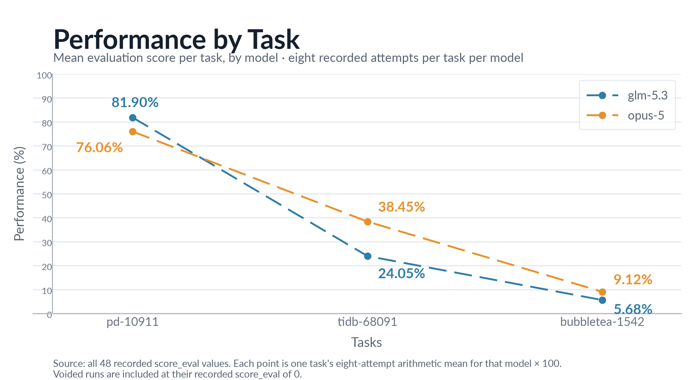
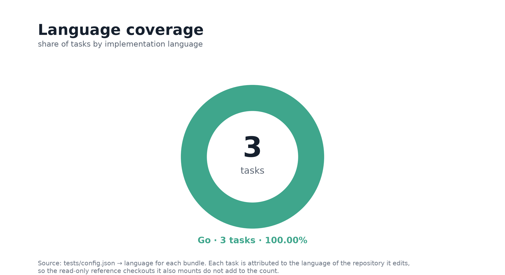

<p align="center">
  
</p>

# Envora: a cross-repository software-engineering benchmark

**Cross-repository software-engineering tasks for frontier coding models.** Each task pairs a
**target repository** the agent edits with a **read-only reference checkout** holding the definitions
the edit must build against, pinned at a commit where those definitions exist. Every bundle ships the
issue prompt, container definitions, reference patch, the complete grading program, and the recorded
agent trajectories.

Tasks and scoring are model-agnostic: attempts land in `trajectories/<model>/` alongside any other
model's. **This release has three tasks and two measured models, `glm-5.3` and `opus-5`, at eight
attempts each 48 runs.** Their mean evaluation score is **39.21%**. Only **2 of 48 runs** turn a
complete fail-to-pass set green, so full-test success is **4.17%** and **1 of 3 tasks** is solved at
least once. The headline includes partial credit; it is not the fraction of tasks solved.

## Summary

| Property | Value |
| --- | --- |
| Tasks | **3**, each a single-issue **cross-repository** task (`read-across-edit-one`) |
| Models measured | **2**: `glm-5.3` (`anthropic/glm-5.3`) and `opus-5` (`anthropic/claude-opus-5`) |
| Agent | `openhands` `1.6.0` for both. Bundles grant `turn_budget = max_turns = 600` and `timeout_sec = 10800.0`; the recorded runs were launched with `max_iterations = 350`. |
| Runs | **8 per task per model; 48 total**, every run 1–8 present |
| Stored difficulty | **`easy` ×1, `medium` ×1, `expert` ×1**, matching the measured tiers |
| Network | Agent phase: `allowlist` to a single gateway host. Verifier: `separate` environment on `allowlist` with `api.anthropic.com` and `api.openai.com` reachable for the rubric judge. The Go toolchain is offline in both phases. |
| Score | `score_eval` in [0, 1], combining test outcome and process |
| Codebases | 5 repositories: 3 targets (`pingcap/tidb`, `tikv/pd`, `charmbracelet/bubbletea`) and 2 reference checkouts (`pingcap/kvproto` at two commits, `charmbracelet/ultraviolet`) |
| Languages | Go 3 |

| Metric | `glm-5.3` | `opus-5` | All 48 runs |
| --- | --- | --- | --- |
| **Mean evaluation score** | **37.21%** | **41.21%** | **39.21%** |
| Mean test-outcome score | 0.3808 | 0.3600 | 0.3704 |
| Mean process score | 0.8760 | 0.8712 | 0.8736 |
| Mean deterministic score | 0.9529 | 0.9434 | 0.9481 |
| Mean rubric score | 0.7991 | 0.7991 | 0.7991 |
| Full-test successes (`all_f2p_green = 1`) | **2 / 24** | **0 / 24** | **2 / 48 (4.17%)** |
| Tasks with at least one full-test success | 1 / 3 | 0 / 3 | **1 / 3** |
| Voided runs (`tamper = 1`) | **6 / 24** | 0 / 24 | **6 / 48** |
| Mean recorded trajectory steps | 170.67 (4,096 total) | 134.04 (3,217 total) | 152.35 (7,313 total) |

`opus-5` leads the overall mean by **4.00 points**, but the two models get there differently:
`glm-5.3` is the only model that ever solves a task outright, and the only one that ever has a run
voided. Those six voids are the whole gap they enter the mean at 0.00%, and across `glm-5.3`'s 18
scored runs the mean is **49.61%**, well ahead of `opus-5`. Step counts are
`len(trajectory["steps"])`; these bundles carry no `n_turns` or `final_metrics.total_steps` field.

## Repository layout

```text
samples/
├── README.md
├── LICENSE
├── images/                                  # charts referenced by this document
├── 954943fb-3f55-54c4-8f36-1d72defcce86/    # pd-10911       (easy)
├── 366c001e-3d60-58ba-a985-96418f6e2289/    # tidb-68091     (medium)
└── 96a0c708-442c-57ca-a015-73a1b357c119/    # bubbletea-1542 (expert)
```

Each UUID directory is a self-contained task bundle: see [Task bundles](#task-bundles) for the 16
files inside one, and [Trajectory structure](#trajectory-structure) for the recorded runs.

## Difficulty tiers

A measured tier comes from the **arithmetic mean of `opus-5`'s eight `score_eval` values**. `glm-5.3`
runs are reported throughout but do not band a task, so the tiers are one model's measurement.

| Tier | Mean `score_eval` band | Task | Runs | Mean score (`opus-5`) | Stored label |
| --- | --- | --- | --- | --- | --- |
| Easy | 0.500 ≤ μ < 0.875 | `tikv__pd-10911` | 8 | 76.06% | `easy` |
| Medium | 0.375 ≤ μ < 0.500 | `pingcap__tidb-68091` | 8 | 38.45% | `medium` |
| Expert | 0 ≤ μ < 0.250 | `charmbracelet__bubbletea-1542` | 8 | 9.12% | `expert` |

The full band set is Trivial 0.875 ≤ μ, Easy 0.500 ≤ μ < 0.875, Medium 0.375 ≤ μ < 0.500, Hard
0.250 ≤ μ < 0.375, Expert μ < 0.250. No task measures Trivial or Hard, and **the stored labels agree
with the measured tiers on all three tasks**, so consumers filtering on `task.toml → difficulty` get
what `opus-5` measured.

**On two tasks the band is basis-independent; on `tidb-68091` it is not.** `pd-10911` and
`bubbletea-1542` land in the same band under `glm-5.3` alone (81.90% Easy, 5.68% Expert) and under
the pooled 16-run mean (78.98% Easy, 7.40% Expert). `tidb-68091` moves: Medium on the documented
`opus-5` basis (38.45%), Hard pooled (31.25%), Expert under `glm-5.3` alone (24.05%). That spread is
produced entirely by three voided `glm-5.3` runs entering at 0.00% across `glm-5.3`'s five scored
runs the task means 38.48%, indistinguishable from `opus-5`'s 38.45%.

## Results

### 1. Per-task performance

| Task | Model | Mean score | Min–max | Full-test successes | Task tier (from `opus-5`) |
| --- | --- | --- | --- | --- | --- |
| [pd-10911](954943fb-3f55-54c4-8f36-1d72defcce86/instruction.md) | `glm-5.3` | **81.90%** | 75.75%–99.77% | 2 / 8 | easy |
| [pd-10911](954943fb-3f55-54c4-8f36-1d72defcce86/instruction.md) | `opus-5` | **76.06%** | 75.38%–76.58% | 0 / 8 | easy |
| [tidb-68091](366c001e-3d60-58ba-a985-96418f6e2289/instruction.md) | `glm-5.3` | **24.05%** | 0.00%–39.24% | 0 / 8 | medium |
| [tidb-68091](366c001e-3d60-58ba-a985-96418f6e2289/instruction.md) | `opus-5` | **38.45%** | 37.87%–38.85% | 0 / 8 | medium |
| [bubbletea-1542](96a0c708-442c-57ca-a015-73a1b357c119/instruction.md) | `glm-5.3` | **5.68%** | 0.00%–9.31% | 0 / 8 | expert |
| [bubbletea-1542](96a0c708-442c-57ca-a015-73a1b357c119/instruction.md) | `opus-5` | **9.12%** | 8.66%–9.52% | 0 / 8 | expert |

The span describes those eight observations; it is not a confidence interval. **Every `glm-5.3`
minimum of 0.00% is a voided run, not a scored failure.**

#### Performance by task

<picture>
  <source media="(prefers-color-scheme: dark)" srcset="images/performance_by_task-dark.png">
  <source media="(prefers-color-scheme: light)" srcset="images/performance_by_task-light.png">
  
</picture>

Tasks run in descending order of pooled mean; **Performance (%)** is each cell's mean `score_eval` ×
100, partial credit included. The lines cross between `pd-10911` and the other two: `glm-5.3` leads
by 5.84 points on the task both models mostly solve, then trails by 14.40 on `tidb-68091` and 3.44 on
`bubbletea-1542` both deficits from voided runs scored at 0.00%, not weaker scored attempts.

### 2. All eight attempts

| Task | Model | R1 | R2 | R3 | R4 | R5 | R6 | R7 | R8 | Mean |
| --- | --- | --- | --- | --- | --- | --- | --- | --- | --- | --- |
| pd-10911 | `glm-5.3` | 75.88% | 76.11% | 76.58% | 75.98% | **98.85%** | **99.77%** | 76.28% | 75.75% | 81.90% |
| pd-10911 | `opus-5` | 76.06% | 76.33% | 76.33% | 76.58% | 75.75% | 76.10% | 75.38% | 75.98% | 76.06% |
| tidb-68091 | `glm-5.3` | _0.00%_ | 38.10% | _0.00%_ | 39.24% | 38.10% | _0.00%_ | 38.71% | 38.25% | 24.05% |
| tidb-68091 | `opus-5` | 38.24% | 38.71% | 38.11% | 38.49% | 38.85% | 38.85% | 38.49% | 37.87% | 38.45% |
| bubbletea-1542 | `glm-5.3` | _0.00%_ | 8.75% | 9.11% | _0.00%_ | 9.26% | _0.00%_ | 9.00% | 9.31% | 5.68% |
| bubbletea-1542 | `opus-5` | 9.00% | 8.97% | 9.52% | 8.75% | 9.52% | 9.37% | 8.66% | 9.16% | 9.12% |

Run numbers identify separate attempts, not stages in a learning curve. **Bold** marks a full
fail-to-pass set turned green; _italic_ marks a voided run. Set those eight runs aside and every
remaining cell spans at most 1.20 points, because the test outcome is constant within a cell and only
the judged rubric moves.

### 3. Outcome and process

| Task | Model | Mean outcome | Mean deterministic | Mean rubric | Mean process | Mean `score_eval` |
| --- | --- | --- | --- | --- | --- | --- |
| pd-10911 | `glm-5.3` | 0.8125 | 0.9643 | 0.7907 | 0.8775 | 0.8190 |
| pd-10911 | `opus-5` | 0.7500 | 0.9524 | 0.7609 | 0.8566 | 0.7606 |
| tidb-68091 | `glm-5.3` | 0.3300 | 0.9444 | 0.7694 | 0.8569 | 0.2405 |
| tidb-68091 | `opus-5` | 0.3300 | 0.9444 | 0.7460 | 0.8452 | 0.3845 |
| bubbletea-1542 | `glm-5.3` | 0.0000 | 0.9500 | 0.8372 | 0.8936 | 0.0568 |
| bubbletea-1542 | `opus-5` | 0.0000 | 0.9334 | 0.8904 | 0.9119 | 0.0912 |

Process is the mean of the deterministic and rubric halves. **Unlike a clean run set the
deterministic half is not constant here**: it spans 0.9334–0.9643, so process variation comes from
both halves. Because process is scored at all, composition lifts every zero-outcome task above zero
`bubbletea-1542` under `opus-5` goes from 0.0000 outcome to 0.0912 evaluation. `score_eval − outcome`
is the net effect of replacing some outcome weight with process, not a separate additive reward.

## Outliers

Two things in this release sit outside the pattern.

**`pd-10911` / `glm-5.3` runs 5 and 6 (98.85%, 99.77%).** The only full-test successes in 48 runs,
and the only bimodal cell: its other six runs cluster in 75.75–76.58%, so the two winners sit **+22.9
points** above their own cell. The entire gap is one test. Nothing in the process channel
distinguishes them they win on outcome by getting
`TestLoadKeyspaceByIDReturnsHeaderError` green, which no `opus-5` run ever does.

**The six voided `glm-5.3` runs (0.00%).** These are not weak attempts; they are disqualified ones.
`tidb-68091` run 1 earned 0.8339 on process. Because a void enters the mean at 0, they invert the
per-task ranking on both unsolved tasks: exclude them and `glm-5.3` means 38.48% on `tidb-68091`
against `opus-5`'s 38.45%, a dead heat rather than a 14.40-point loss. **Reporting voids as zeros is
correct but makes a tamper-prone model look weak rather than non-compliant** the two failure modes
are worth reading separately.

## Coverage

<picture>
  <source media="(prefers-color-scheme: dark)" srcset="images/language_coverage-dark.png">
  <source media="(prefers-color-scheme: light)" srcset="images/language_coverage-light.png">
  
</picture>

**Go 3 tasks (100.00%)**, read from each `tests/config.json → language`. A task is attributed to the
language of the repository it *edits*, so read-only reference checkouts do not add to the count.
**This release is single-language**; the chart is kept so the shape stays comparable as others land.

## Task bundles

```text
<uuid>/
├── task.toml                  # identity, stored difficulty, repos, resources, network policy
├── instruction.md             # issue prompt plus the workspace repository table
├── environment/Dockerfile     # agent environment definition
├── solution/
│   ├── fix.patch              # supplied reference patch
│   ├── solve.sh               # reference-patch application script
│   └── TRUTH.md               # reference account of defects and requirements
└── tests/
    ├── Dockerfile             # verifier image, built with tests/ as its context
    ├── config.json            # repository, base commit, language, F2P/P2P sets, judge pin
    ├── test.patch             # grading tests
    ├── test.sh                # verifier entrypoint and channel orchestrator
    ├── run_tests.py           # standalone graded-test runner for triage
    ├── test_output.py         # source-site probes as pytest tests (the if_score channel)
    ├── llm_judge.py           # rubric judge: builds evidence, calls the pinned model
    ├── process_record.py      # deterministic checks, gate, and score composition
    ├── rubrics.json           # process criteria, check definitions, source-site probes
    └── test_weights.json      # per-site probe weights
```

All three bundles carry exactly these **16 files**, ten under `tests/`. Four grading files are
byte-identical across all three bundles `test.sh` (1,287 lines), `llm_judge.py` (2,256),
`process_record.py` (2,202), `run_tests.py` (106) so **the grader is one program parameterised by
`config.json` and `rubrics.json`, not three forks of it**. `Dockerfile`, `config.json`,
`test_output.py`, `rubrics.json`, `test_weights.json`, and `test.patch` are per-task.

## Trajectory structure

```text
<uuid>/trajectories/<model>/run_N/    # one directory per measured model; N = 1…8
├── result.json                        # agent metrics, scores, verifier rewards, assay
├── config.json                        # run configuration
├── agent/
│   ├── trajectory.json                # ATIF-v1.7 structured trace
│   └── openhands.txt                  # agent console log
├── artifacts/
│   ├── agent.patch                    # recorded agent diff
│   └── manifest.json                  # artifact index
└── verifier/
    ├── final_score.md                 # readable score breakdown
    ├── test-stdout.md                 # test execution output
    ├── outcome.json                   # fail-to-pass and preserve-set resolution
    ├── process.json                   # detailed process, checks, and composed scores
    ├── reward.json                    # reward record
    ├── reward.txt                     # reward scalar
    └── verdicts.jsonl                 # process judge log
```

All 48 runs carry the same **13 files**, so there are no per-run reporting gaps. Outcome and process
values come from `result.json` top level (`score_outcome`, `score_process`, `score_eval`, `score_rl`) and the
`assay` block; detailed counterparts live in `verifier/process.json` and `verifier/outcome.json`.

## Grading pipeline

`tests/test.sh` grades one trial, in a `separate` container from the agent, with a 2,700-second
budget. The agent's work arrives as an artifact patch rather than a live checkout: `/opt/pristine`
holds each repository's agent-start tree, and the verifier reconstructs a per-repository
`agent_<repo>.patch` by diffing the graded tree against it. Task identity editable repository,
read-only sibling, sibling module path is derived from `config.json → workdir` and
`config.json → judge.bundle`, so one script serves all three bundles.

| Channel | Produced by | Lands in |
| --- | --- | --- |
| `reward` / `outcome` | `test.sh`, from the declared F2P/P2P ids | `reward.json`, `reward.txt`, `outcome.json` |
| `if_score` | `test_output.py` under pytest → junit XML → `site_channel.json` | `process.json → if` |
| `quality_score` | `llm_judge.py`, calling the model pinned in `config.json → judge` | `process.json → judge`, `verdicts.jsonl` |
| composition | `process_record.py` | `process.json`, `final_score.md` |

### Source-site probes: the `if_score` channel

`tests/test_output.py` is the site-check table one pytest test per rubric requirement and
`test.sh` converts its junit XML into the channel. Verdicts map onto pytest directly: pass is `pass`,
failure is `fail`, and `pytest.skip` is `abstain`.

### Rubric judge: the `quality_score` channel

`tests/llm_judge.py` builds the evidence bundle, calls the pinned model, and writes
`quality_channel.json` plus one verdict line per rubric item.

| `config.json → judge` | Value |
| --- | --- |
| `judge_version` / `prompt_version` | `diff-judge-v2.1.0-openai` / `diff-judge-prompt-v2` |
| `rubric_version` | `quality-v1.1.0` (must match `rubrics.json`, or the judge refuses to call) |
| `effort` / `max_tokens` | `high` / 12,000 (`max_completion_tokens`, reasoning effort on) |
| `samples` / `council` | 1 / `majority` |
| `timeout_sec` / `max_retries` | 600 / 2 |
| `judged_targets` / `trajectory_targets` | `final_diff` / `trajectory`, `verification_output` |
| `caps` | `tamper_zeroes_quality: true`, `build_failure_cap: 0.25` |

Abstained items leave the denominator entirely, so an unjudgeable item neither rewards nor punishes.
**In the 48 recorded runs no item ever abstained.**

### Deterministic checks, the gate, and composition

`tests/process_record.py` reads the graded artifacts, both side channels, the reconstructed agent
patches, and the optional trajectory, then writes `process.json`, `final_score.md`, and
`verdicts.jsonl`. It emits the `A`/`B`/`C`/`D`/`E`/`F` check families plus one `E1-touched` per source
site and one `E2-req` per site requirement.

**Hard checks gate; soft checks score.** A hard failure sets `gate = 0` and status `voided`, zeroing
`score_eval` no matter how well the rubric scored exactly what happened on the six `glm-5.3` runs.
`score_deterministic` is the weight-weighted pass fraction over soft checks only, and abstained soft
checks drop out of the denominator.

The judge model is pinned in `config.json`, but each `JUDGE_*` variable in
`task.toml → [verifier.env]` can override it at run time (`JUDGE_PROVIDER`, `JUDGE_MODEL`,
`JUDGE_EFFORT`, `JUDGE_MAX_TOKENS`, `JUDGE_COUNCIL`, `JUDGE_SAMPLES`, `JUDGE_TIMEOUT_SEC`,
`JUDGE_OPENAI_MAX_TOKENS_FIELD`).

## Scoring methodology

### Mean evaluation score and full-test success

```text
cell mean              = sum(score_eval for runs 1…8) / 8
task mean              = sum(score_eval for both models' 16 runs) / 16
overall mean           = sum(all 48 score_eval) / 48
full-test success rate = count(all_f2p_green == 1) / 48
observed task coverage = count(tasks with any all_f2p_green == 1) / 3
```

Because the grid is balanced at 8 runs per cell, a model's overall mean equals the mean of its three
task means. **Mean evaluation score** is the continuous average, kept distinct from success within
eight attempts: coverage here is **1 / 3**, the mean evaluation score **39.21%**.

### Outcome and process

The stored continuous values reproduce this calculation from the records:

```text
recall     = f2p_passed / f2p_declared             # × regression_factor when the preserve set breaks
outcome    = round(recall, 2)                      # the value stored as score_outcome
rubric     = 0.05 + 0.95 × min(1, earned / total)  # floor band; rubric_raw is the unfloored ratio
process    = (score_deterministic + score_rubric) / 2
gap        = max(1 / f2p_declared, 0.02)
α          = min(0.05, gap / (2 × (1 + gap)))
score_eval = gate × ((1 − 2α) × recall + 2α × process)
```

**The rubric half never reports a bare 0**: a run satisfying nothing still scores the 0.05 floor, with
the judged ratio compressed into the remaining 0.95. That formula reproduces the stored `rubric` on
all 48 records from the `earned`/`total` pair in `rubric_detail`. Negative-weight guardrail items
subtract from the numerator when they fire; abstained items leave `total` altogether.

**α is derived, not configured.** The smallest meaningful outcome step is `1/f2p_declared`, and α is
half that step relative to the whole. With 4, 6, and 2 fail-to-pass tests the uncapped values are
0.100, 0.071, and 0.167, so **the 0.05 cap binds on all three tasks** and α is 0.05 everywhere
making the process weight exactly **10%** and outcome **90%**. Larger graded sets would let α float
below the cap.

| Worked example | recall | process | `score_eval` |
| --- | --- | --- | --- |
| `pd-10911/opus-5/run_1` | 0.75 | 0.8563 | `0.9 × 0.75 + 0.1 × 0.8563` = **0.7606** |
| `tidb-68091/opus-5/run_1` | 2/6 = 0.3333 (stored 0.33) | 0.8241 | `0.9 × 0.3333 + 0.1 × 0.8241` = **0.3824** |
| `pd-10911/glm-5.3/run_6` | 1.00 | 0.9771 | `0.9 × 1.00 + 0.1 × 0.9771` = **0.9977** |

`score_rl` uses the same composition with process normalized within an outcome stratum, and is not
used for this report's means or tiers. **`stratum_size` is 1 on all 48 runs**, so
`process_stratified` degenerates to 0.5 and `score_rl` reduces to `gate × (0.9 × recall + 0.05)`
0.725, 0.35, and 0.95 for the three rows above. The stratification is inert in this release.

<details>
<summary>Task identities, pinned commits, and graded test sets</summary>

| Task | UUID | Target repo @ base commit | Reference checkout @ pinned commit | F2P | P2P |
| --- | --- | --- | --- | --- | --- |
| pd-10911 | `954943fb-3f55-54c4-8f36-1d72defcce86` | `tikv/pd` @ `4ae1408fef038e2c41526556d83c9b7c0e98e021` | `pingcap/kvproto` @ `b41e86365ce0e0fba482005c0dfa5e2ca967d74c` | 4 | 5 |
| bubbletea-1542 | `96a0c708-442c-57ca-a015-73a1b357c119` | `charmbracelet/bubbletea` @ `8f17c3584f3df68f12703cb0f5e58f482f2e5d62` | `charmbracelet/ultraviolet` @ `9deacb990ee730bd234d9229d8b823b5b372b39f` | 2 | 2 |
| tidb-68091 | `366c001e-3d60-58ba-a985-96418f6e2289` | `pingcap/tidb` @ `693e52cd51bd8565795ad9c650dd8ac743fc26fe` | `pingcap/kvproto` @ `a15c348f8713e5c492b6dfb41224c464b5824979` | 6 | 3 |

| Task | Upstream PR | Title | License |
| --- | --- | --- | --- |
| pd-10911 | [tikv/pd#10911](https://github.com/tikv/pd/pull/10911) | keyspace: load keyspace by ID through gRPC | Apache-2.0 |
| bubbletea-1542 | [charmbracelet/bubbletea#1542](https://github.com/charmbracelet/bubbletea/pull/1542) | v2: Support mode 2026 (synchronized output updates) | MIT |
| tidb-68091 | [pingcap/tidb#68091](https://github.com/pingcap/tidb/pull/68091) | *: add tidb_paging_size_bytes and forward it to coprocessor RPC | Apache-2.0 |

**Graded test sets.**

- `pd-10911` F2P: `client/keyspace_client_test.go::TestLoadKeyspaceByID`,
  `::TestLoadKeyspaceByIDReturnsHeaderError`, `::TestLoadKeyspaceByIDReturnsProtoClientError`,
  `::TestLoadKeyspaceByIDReturnsRPCError`. P2P: five tests in `client/client_test.go`.
- `bubbletea-1542` F2P: `screen_test.go::TestViewModel`, `screen_test.go::TestClearMsg`.
  P2P: `tea_test.go::TestTeaModel`, `commands_test.go::TestBatch`.
- `tidb-68091` F2P: `pkg/store/copr/coprocessor_test.go::TestBuildCopTasksWithPagingSizeBytes`,
  `pkg/store/copr/coprocessor_cache_test.go::TestBuildCacheKey`, `::TestGetSet`,
  `pkg/store/copr/copr_test/coprocessor_test.go::TestBuildCopIteratorWithBatchStoreCopr`,
  `pkg/distsql/request_builder_test.go::TestRequestBuilderKeepsPagingSizeBytesWhenPagingDisabled`,
  `pkg/distsql/context/context_test.go::TestContextDetach`.
  P2P: `::TestBuildPagingTasksDisablePagingForSmallLimit`,
  `pkg/distsql/request_builder_test.go::TestRequestBuilder1`, `::TestRequestBuilder2`.

</details>
